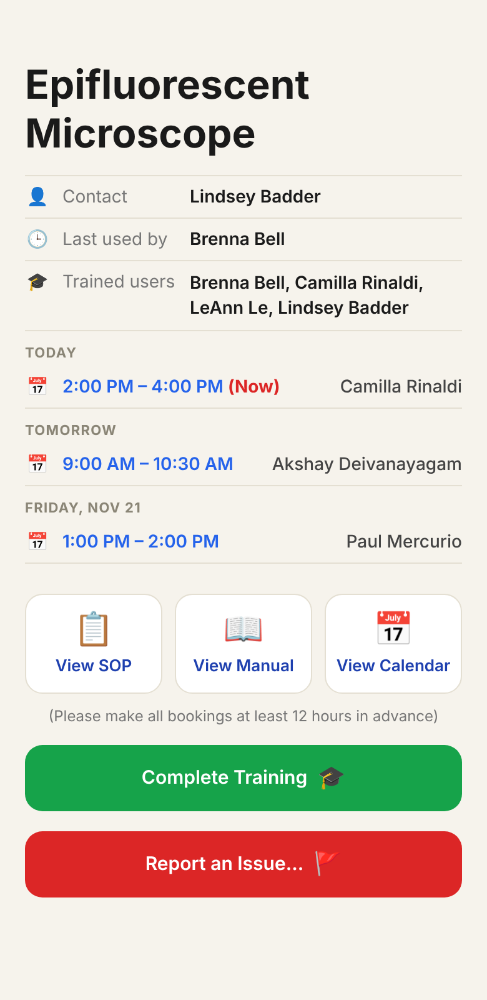
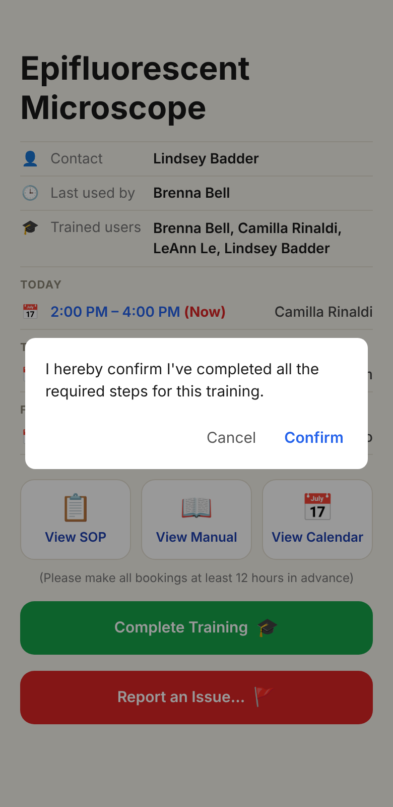
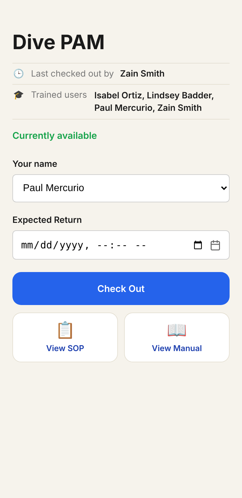
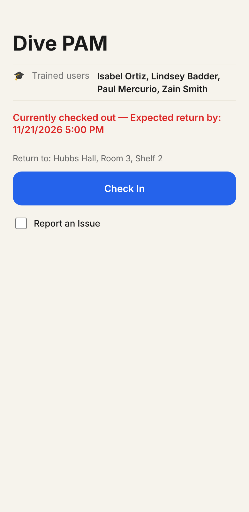
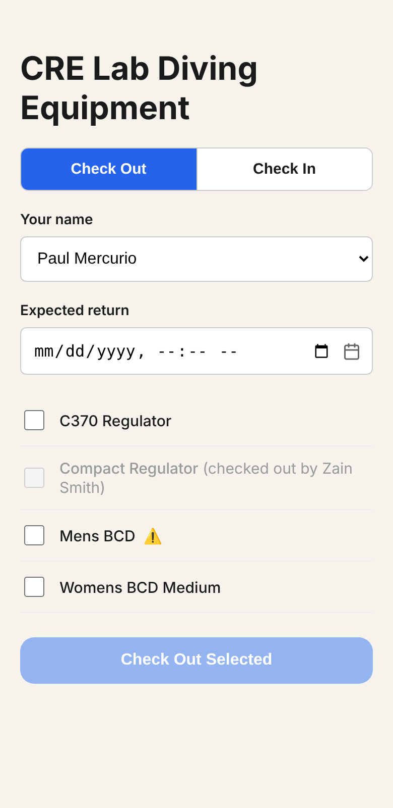
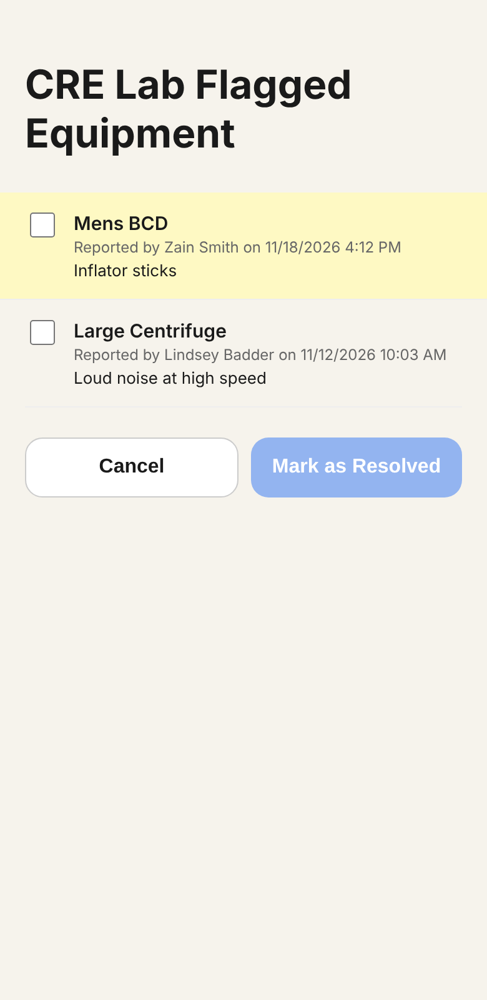
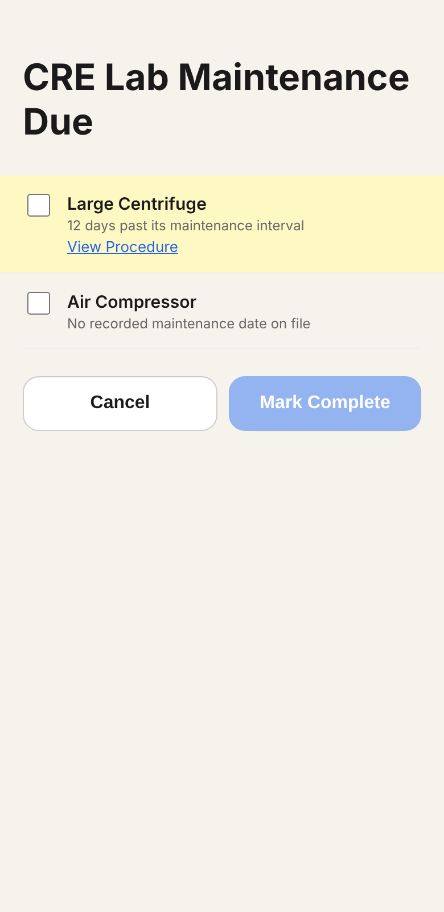

# Lab Equipment QR Checkout

A Google Apps Script web app, bound to the lab's equipment Google Sheet, that turns a QR code on each piece of equipment into a small mobile page: check it out or in, see who's trained and what's booked, view the SOP/manual/calendar, report issues, and get Slack reminders for overdue returns and scheduled maintenance.

The Google Sheet is the single source of truth. The app only reads from and writes to it, so anyone can inspect or fix the data by hand.

## Screenshots

| Item info (no checkout) | Complete Training confirm | Checkout |
|---|---|---|
|  |  |  |

| Check in | Bulk category checkout | Issues | Maintenance due |
|---|---|---|---|
|  |  |  |  |

*Screenshots are rendered locally with sample data, not real lab records.*

## What it does

**Scanning an item's QR code** (`?item=<Equipment name>`) opens one of two pages:

- **Checkout / check-in** (`CheckoutPage.html`) for items where `Can Check Out?` is Yes. Pick your name (auto-selected from your signed-in Google account), choose an expected return time, and check out. Scanning again shows Check In, the "Return to" location, and a Report an Issue option. Flagged items show a warning that must be confirmed.
- **Info only** (`NoCheckoutPage.html`) for items that aren't checked out (microscopes, centrifuges, etc.). Shows the point of contact, who last used it (from the calendar), trained users, and upcoming bookings through Friday, with SOP / Manual / Calendar tiles and a Report an Issue button.

Both pages show a **Trained users** row. If the item has `Requires Training?` set to Yes and you aren't listed yet, a green **Complete Training** button appears. After you confirm, your full name is appended to the item's `Trained Users` cell.

**Other pages**

| URL | Page |
|---|---|
| `?view=diving-checkout` | Bulk checklist of every Diving item with `QR?` = Yes |
| `?view=photography-checkout` | Same for Photography |
| `?view=issues` | All open issues; resolve them in bulk |
| `?view=maintenance` | Items due for maintenance; mark complete |

Both bulk pages use the shared `CategoryCheckoutPage.html`. Adding a category is one route in `doGet` plus a QR code.

**Slack** (optional): issue reports post to a channel with a link back to the issue; overdue returns DM the borrower; scheduled maintenance posts a reminder. A checkmark reaction is added when an issue is resolved or maintenance completed. Reminders skip weekends.

## Repo layout

```
src/                     Everything that goes into the Apps Script project
  Code.gs                Routing, checkout logic, calendar bookings, training
  Issues.gs              Issue Slack posts + overdue-return reminders
  Maintenance.gs         Recurring maintenance reminders
  SlackShared.gs         Slack config, WEB_APP_URL, helpers
  CheckoutPage.html      Checkout / check-in page
  NoCheckoutPage.html    Info-only page
  CategoryCheckoutPage.html  Bulk checkout page (Diving, Photography, ...)
  IssuesPage.html, MaintenancePage.html
data/qr_checkout_urls.csv   One QR URL per item
docs/screenshots/           Images used above
docs/design-mockups/        Design experiments (static HTML, open in a browser)
```

## Spreadsheet structure

| Sheet | Columns |
|---|---|
| **Inventory** | `Equipment`, `Checked Out?`, `Needs Maintenance?`, `Flagged?`, `Can Check Out?`, `Point of Contact`, `Category`, `QR?`, and optionally `SOP Link`, `Manual Link`, `Calendar`, `Trained Users`, `Requires Training?`, `Building`, `Room`, `Location` |
| **Checkout Log** | `Equipment`, `User`, `Check Out Time`, `Check In Time`, `Expected Return`, `Last Overdue Reminder` |
| **Users** | `Name`, `Email`, `Quantity Checked Out`, `Slack ID`, `Admin` (email and Slack ID are optional) |
| **Issues** | `Equipment`, `Reported By`, `Reported At`, `Details`, `Slack Ts` |
| **Maintenance Schedules** | `Equipment`, `Interval (Days)`, `Last Maintained`, `Last Reminder Sent`, `Maintenance Procedure`, `Slack Ts` |

Notes:
- `Flagged?` and `Needs Maintenance?` are derived by the app (from the Issues and Maintenance Schedules sheets), not set by hand.
- `Calendar` takes a Google Calendar link (an embed `?src=` link, an add `?cid=` link, or a bare calendar ID). Calendar lookups run as the deployment owner, so visitors don't need access to the calendar.
- `Trained Users` is one cell of full names separated by commas. `Complete Training` appends to it.
- If there is no `Requires Training?` column, any item with at least one trained user is treated as requiring training.
- `Point of Contact` can hold several names ("Zain Smith/Katy"); they're resolved to Slack mentions where possible.

## Setup

1. Create the Google Sheet with the tabs above.
2. **Extensions → Apps Script**, then add every file in `src/` (`.gs` files as scripts, `.html` files as HTML files with the same name, no extension).
3. **Slack (optional):** follow the steps at the top of `SlackShared.gs`. Fill in `SLACK_BOT_TOKEN` and `ISSUE_REPORT_SLACK_CHANNEL_ID`. Bot scopes: `chat:write`, `reactions:write`, `im:write`. People are matched to Slack through the `Slack ID` column on the Users sheet, so no user-listing scope is needed.
4. **Giphy (optional, used for the Report an Issue animation):** replace `YOUR_GIPHY_API_KEY` in `CheckoutPage.html` and `NoCheckoutPage.html` with a free key.
5. **Deploy → New deployment → Web app.** Execute as **Me**, access **Anyone within your domain** (so `Session.getActiveUser()` can identify visitors).
6. Copy the deployment URL into `WEB_APP_URL` in `SlackShared.gs`. This is hardcoded because `ScriptApp.getService().getUrl()` returns the wrong URL when called from a time-driven trigger.
7. **Authorize Calendar access** once by running any function that touches `CalendarApp` from the editor.
8. **Triggers** (clock icon): `checkOverdueReturnsAndNotify` every 15 minutes or hourly, and `checkMaintenanceSchedulesAndNotify` daily.
9. Generate QR codes from `data/qr_checkout_urls.csv`, plus one each for the bulk pages.

### Updating

Changing code does nothing for the live URL until you redeploy: **Deploy → Manage deployments → edit → Version: New version**. Edit the existing deployment rather than creating a new one, so the URL (and every printed QR code) stays the same. If a new deployment is ever created, update `WEB_APP_URL` and regenerate the QR codes.

## Security notes

- `SLACK_BOT_TOKEN` should stay a placeholder in anything committed to git. Prefer Script Properties (Project Settings) for real secrets.
- `WEB_APP_URL` and `data/qr_checkout_urls.csv` contain the deployment URL. Access is limited by the deployment's domain setting, but consider keeping the repo private.
- The Complete Training button is an honor system: anyone signed in and listed on the Users sheet can add themselves.
